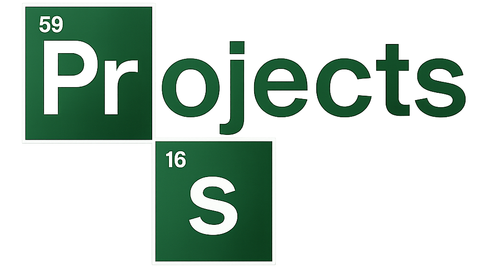

👋 Hi, I'm Prince 
🚀 Student Developer | AI & Quantum Explorer  

<p align="center">
  
</p>

---
## 👨‍💻 About Me
 
```typescripthy
const qbit = {
  name: "Ahuah-Debrah Prince Thomas",
  location: "Ghana 🇬🇭",
  role: "Student Developer | AI & Quantum Explorer",
  pronouns: "he/him",
 
  currentlyBuilding: [
    "StockPilot (Inventory Management System)", 
    "QuantaFlood (Quantum-Assisted Flood Detection System)"
  ],
  currentlyLearning: [
    "Quantum Computing (QFT)", 
    "AWS Cloud Computing", 
    "IoT & Edge Computing"
  ],
  lookingToCollaborate: "Open-Source Web & Intelligent Systems Projects",

  askMeAbout: [
    "Web Development", 
    "Cloud & AWS Projects", 
    "IoT & Edge Computing Solutions", 
    "AI, Quantum Computing & Research Projects"
  ],
 
  funFact: "Turning 'I don't know how it works' into 'Let's build it and find out' on a weekly basis.",
  
  contact: "quofiobrien007@gmail.com",
};
```


---
### 🛠 Tools  
<p align="center">
  <!-- Programming Languages -->
<b>💻 Languages</b><br/>
<br/><br/>

<!-- Frameworks & Libraries -->
<b>🌐 Frameworks & Libraries</b><br/>


---
### 🤖 AI & Data


---
### ☁️ Cloud & IoT


---
### 🗄️ Databases


---
### 🧰 Tools


---
### ⚛️ Quantum


</p>

---

> [!NOTE]  
> 📝 The icons above showcase the languages, frameworks, tools, and platforms I've worked with and am actively exploring, from low-level languages like **C/C++**, to web technologies like **HTML, CSS, JavaScript, PHP, React, Node.js**, to **Python** for AI and quantum computing with **TensorFlow** and **Qiskit**. They also cover databases (**MySQL, SQLite, MongoDB**), cloud and IoT tools (**AWS, Arduino, Raspberry Pi**), and operating systems (**Linux distros, Windows**).  
> 🚀 They represent my academic background, personal projects like **StockPilot** and **QuantaFlood**, and the technologies I'm still learning, including **Quantum Computing (QFT)**, **AWS Cloud**, and **IoT & Edge Computing**.


---

<p align="center">
  
</p>

## 🚀 What I'm Working On

| Project | Description | Status |
|--------|-------------|--------|
| 📦 **[StockPilot](https://github.com/Prince-Qbit/INVENTORY-MANAGEMENT-SYSTEM-.git)** | Inventory management system for tracking stock, sales & suppliers | 🟢 Active |
| 🌊 **[QuantaFlood](https://github.com/Prince-Qbit/QuantaFlood-.git)** | Quantum-assisted flood detection system using IoT, edge computing & AI | 🟡 Research |
 


## 📊 GitHub Stats
 
---

## 📊 GitHub Stats

<p align="center">
  
  
</p>

<p align="center">
  
</p>

<p align="center">
  
</p>

<p align="center">
  
</p>

> [!NOTE]  
> 📈 These stats reflect my journey as a student developer, from web projects like **StockPilot** to research in **AI, Quantum Computing, and IoT** with **QuantaFlood**. Expect more **Python**, **JavaScript**, and cloud-focused commits as I keep learning.---
 
## 🏆 GitHub Trophies
 
<div align="center">
  
</div>

## 📌 Profile Insights
 
<div align="center">
  
</div>

<div align="center">
  
  
</div>
---

### 📈 Contribution Activity  

<p align="center">
  <!-- Activity Graph - Using ashutosh00710's repo -->
  
  <!--  -->
</p>


<!--
### 🧩 LeetCode Stats  
<p align="left">
   <!-- line 4: replace YOUR-LEETCODE-USERNAME with your handle -->
</p>
-->

---

<!-- Contributions 3D GitHub -->


<!-- Snake Animation con enlace a Platane/snk -->
<picture>
  <source media="(prefers-color-scheme: dark)" srcset="https://raw.githubusercontent.com/platane/platane/output/github-contribution-grid-snake-dark.svg">
  <source media="(prefers-color-scheme: light)" srcset="https://raw.githubusercontent.com/platane/platane/output/github-contribution-grid-snake.svg">
  
</picture>

_generated with [Platane/snk](https://github.com/Platane/snk)_


<!-- Visitor Counter -->
<p align="center">
  <a href="https://count.getloli.com/" target="_blank">
    
  </a>
</p>


### 🤝 Connect with Me  
<p align="left">
  <a href="https://www.linkedin.com/in/princeqbit" target="_blank"></a> <!-- placeholder -->
  <!-- <a href="https://x.com/Prince_Qbit" target="_blank"></a> <!-- placeholder -->
  <a href="mailto:quofiobrien007@gmail.com"></a> <!-- placeholder -->
</p>
